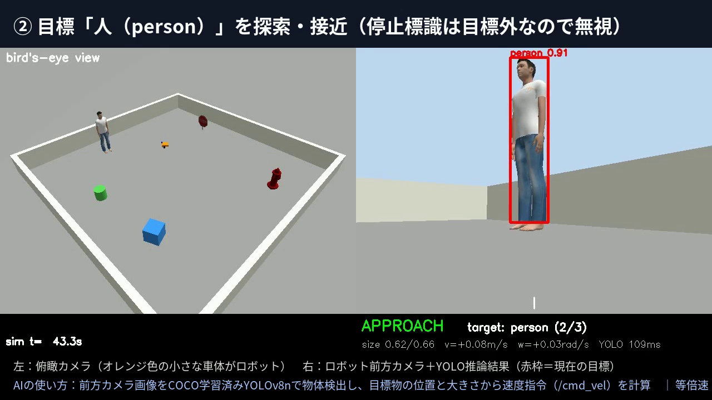

# pai-yolo-rover：YOLOで目標物を「探して・近づく」差動二輪ロボット

Physical AI 応用編1 最終課題。ROS 2 Humble＋Gazebo（Classic 11）上の差動二輪ロボットが、前方カメラ画像をYOLO（COCO学習済みYOLOv8n、**推論のみ**）で物体検出し、指定した順番（既定：停止標識 → 人 → 消火栓）で目標物を自律的に探索・接近・到着判定します。



- 左：俯瞰カメラ（デモ動画用の固定カメラ）　右：ロボット前方カメラ＋YOLO推論結果（赤枠＝現在の目標）
- ベースにしたサンプル：「ROS2とGazeboの連携によるロボット操作」（差動二輪ロボットをROS 2からGazebo上で動かす）。手動操作だった部分を、AIの認識結果で動く自律制御に置き換えています。

## 動作の流れ

| 状態 | 動き |
|---|---|
| `SEARCH` | その場で旋回して目標物を探す（約1.2回転しても見つからなければ少し前進して探し直す） |
| `APPROACH` | 検出枠の中心が画像中央に来るよう角速度をP制御し、枠が小さいほど速く・中心からずれているほど遅く前進 |
| `ARRIVED` | 検出枠の大きさ（画像に占める割合）が目標物ごとのしきい値を超えたら到着とみなし、2秒停止 |
| `BACKOFF` | 少し後退してから次の目標物の探索へ |
| `RECOVER` | 前進指令を出しているのにオドメトリが動かない状態が3秒続いたら（障害物に接触）、後退→向きを変える→前進して探索に戻る |
| `DONE` | すべての目標に到達したら停止 |

目標外の物体（人、箱、円柱など）は検出しても無視します（灰色の枠で表示）。

## ファイル構成

```
pai_yolo_rover/                 ROS 2 パッケージ（ament_python）
├── pai_yolo_rover/
│   ├── yolo_search_node.py     YOLO推論＋状態遷移＋速度指令（/cmd_vel）
│   └── demo_recorder.py        俯瞰カメラ＋YOLO画像を並べた動画をシミュレーション時間基準で記録
├── launch/
│   ├── sim.launch.py           Gazebo＋ロボットのみ（手動操作用）
│   └── mission.launch.py       Gazebo＋ロボット＋YOLO探索ノード（＋録画）
├── urdf/rover.urdf.xacro       差動二輪ロボット（diff_driveプラグイン、カメラ）
├── worlds/patrol_room.world    9m四方の部屋、目標物3つ、目標外の物体2つ、俯瞰カメラ
├── config/yolo_search.yaml     しきい値・ゲイン等のパラメータ
└── models/                     Gazeboモデル（osrf/gazebo_models より、CC BY 3.0）
tools/make_video.py             録画したAVIに字幕を付けて提出用MP4にする（任意）
```

## 実行方法（講義のDocker環境）

講義で使った `airobotbook/ros2-desktop-ai-robot-book-humble`（Ubuntu 22.04＋ROS 2 Humble＋Gazebo 11、ブラウザ `localhost:6080` で操作）を想定しています。

### 1. コンテナを起動してブラウザで開く

```bash
# 初回（第5回の起動スクリプトと同じ形）
docker run -d --name pai_ros2 -p 6080:80 --shm-size=512m \
  -v "$(pwd)":/workspace airobotbook/ros2-desktop-ai-robot-book-humble:latest
# 2回目以降
docker start pai_ros2
```
ブラウザで http://localhost:6080 を開き、デスクトップのターミナルで以下を実行します。

### 2. YOLO（ultralytics）を入れる

```bash
# PyTorchはCPU版を先に入れる（PyPIの既定版はCUDA込みで数GBになるため）
pip3 install torch torchvision --index-url https://download.pytorch.org/whl/cpu
# ROS 2 Humble付属ライブラリとの互換のため numpy は 1.x に固定
pip3 install ultralytics "numpy<2"
```
初回実行時に学習済みモデル `yolov8n.pt`（約6MB）が自動でダウンロードされます。

### 3. ビルド

```bash
mkdir -p ~/pai_ws/src && cd ~/pai_ws/src
git clone <このリポジトリのURL>
cd ~/pai_ws
rosdep install --from-paths src --ignore-src -r -y
colcon build --symlink-install --packages-select pai_yolo_rover
source install/setup.bash
```

### 4. 実行

```bash
# 全自動デモ（Gazebo画面＋YOLO推論画面のウィンドウが開く）
ros2 launch pai_yolo_rover mission.launch.py

# 目標物の順番を変える（COCOのクラス名で指定）
ros2 launch pai_yolo_rover mission.launch.py targets:="['person', 'fire hydrant', 'stop sign']"

# デモ動画を記録する（Ctrl+Cで終了すると ~/pai_demo.avi に保存）
ros2 launch pai_yolo_rover mission.launch.py record_video:=true

# ロボットを手動で動かすだけ（サンプル記事と同じ操作）
ros2 launch pai_yolo_rover sim.launch.py
ros2 run teleop_twist_keyboard teleop_twist_keyboard
```

主なトピック：`/camera/image_raw`（前方カメラ）、`/cmd_vel`（速度指令）、`/odom`、`/yolo_search/annotated`（推論結果画像）、`/yolo_search/status`（状態）、`/overhead/image_raw`（俯瞰カメラ）。

### 録画をMP4にする

```bash
sudo apt install -y ffmpeg
ffmpeg -i ~/pai_demo.avi -c:v libx264 -pix_fmt yuv420p pai_demo.mp4
# 字幕・タイトル付きにする場合（日本語フォント Noto Sans CJK が必要）
python3 tools/make_video.py ~/pai_demo.avi pai_demo_final.mp4
```

## パラメータ（config/yolo_search.yaml）

| 名前 | 既定値 | 意味 |
|---|---|---|
| `targets` | `['stop sign', 'person', 'fire hydrant']` | 訪問する目標物（COCOクラス名）と順番 |
| `conf` | 0.25 | YOLOの検出しきい値 |
| `arrive_overrides` | stop sign 0.42 / fire hydrant 0.45 / person 0.66 | 到着とみなす検出枠の大きさ（物体ごと） |
| `k_ang` | 1.1 | 中心合わせのPゲイン |
| `max_lin_vel` / `search_ang_vel` | 0.35 m/s / 0.45 rad/s | 接近・探索の速さ |
| `device` | cpu | GPUがあれば `0` |

## うまく動かないとき

- **Gazeboが重い／止まる**：Docker Desktopのメモリ割り当てを8GB以上に。Apple SiliconのMacではamd64エミュレーションになるため遅くなります。
- **`ImportError: numpy` 系のエラー**：`pip3 install "numpy<2"` を再実行。本ノードはcv_bridgeを使わずに画像を変換しているので、numpyの版の影響を受けにくくしています。
- **人が見つからない／停止位置が遠い・近い**：`arrive_overrides` と `conf` を調整。

## 使用したもの・ライセンス

- ROS 2 Humble、Gazebo 11（gazebo_ros_pkgs の diff_drive / camera プラグイン）
- Ultralytics YOLOv8n（COCO学習済み、推論のみ。AGPL-3.0）
- Gazeboモデル `stop_sign` `person_standing` `fire_hydrant`：[osrf/gazebo_models](https://github.com/osrf/gazebo_models)（CC BY 3.0、`pai_yolo_rover/models/LICENSE_gazebo_models.txt`）
- 本リポジトリのコード：Apache-2.0
